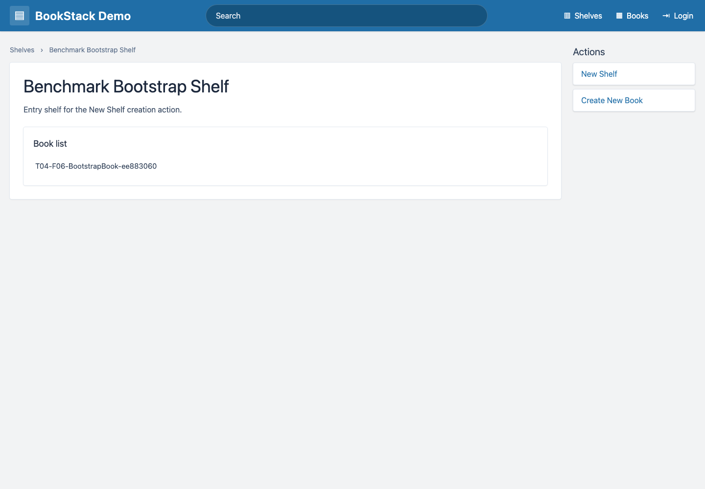

# WB-05 — Creating a book modifies the immutable bootstrap shelf

**Method:** white-box test of inconsistent bootstrap protection. Shelf update/delete handlers reject `is_bootstrap`, and the UI hides those actions. The shelf-book creation path checks only existence, then writes a book referencing that shelf. Select the bootstrap shelf to exercise this unprotected path. [Protected handlers](../../backend/src/slices/bookstack.ts#L277) · [Unprotected book creation](../../backend/src/slices/bookstack.ts#L301) · [UI condition](../../frontend/src/slices/bookstack.tsx#L263).

**Requirement:** REQ-4.3 describes the bootstrap shelf with “no tags and no books” and says “It remains an immutable entry shelf for New Shelf; shelves created by the user are separate objects.” This case interprets immutability as also protecting its related-book collection. [Requirement](../../requirements/requirements.yaml#L248). If the course intends only name/description immutability, this candidate needs clarification before receiving credit.

**Baseline difference:** [REQ-4.3](../baseline/REQ-4.3.spec.ts) uses the bootstrap as the New Shelf entry point; [REQ-5.6](../baseline/REQ-5.6.spec.ts) creates books under ordinary, UI-created shelves. Neither checks this protected object through the nested book-creation path. [WB-04](white-box-04.md) tests a different path: a new-shelf identity collision, not mutation through book creation.

1. Use the separate in-memory instance from the [README](README.md#run-manually), not a shared persistent instance; remain anonymous.
2. Open Shelves → Benchmark Bootstrap Shelf. Confirm its Book list is empty and Edit/Delete are absent.
3. Click Create New Book. Enter a unique name B, description `Team 04 isolated test fixture`, and tags `team04`. Click Save Book.
4. On B's details, click the Benchmark Bootstrap Shelf parent action. Reload the shelf and inspect Book list.

**Expected under the immutable-shelf contract:** the protected shelf's book collection stays unchanged; the action is unavailable or rejected. **Actual:** save returns HTTP 200, B is associated with the bootstrap shelf and remains there after reload. Both independent runs recorded one matching entry where the assertion expected zero. No private API requests or storage injection were used; the script only observes the save response generated by the UI.

**Automation:** `npm test -- --grep F06`. The in-memory instance is stopped afterward, so this experiment leaves the user's existing bootstrap shelf intact.

[Run 1 observations](assets/run-1/F06.json) · [Run 2 observations](assets/run-2/F06.json) · [Assertions](faults.spec.ts)
